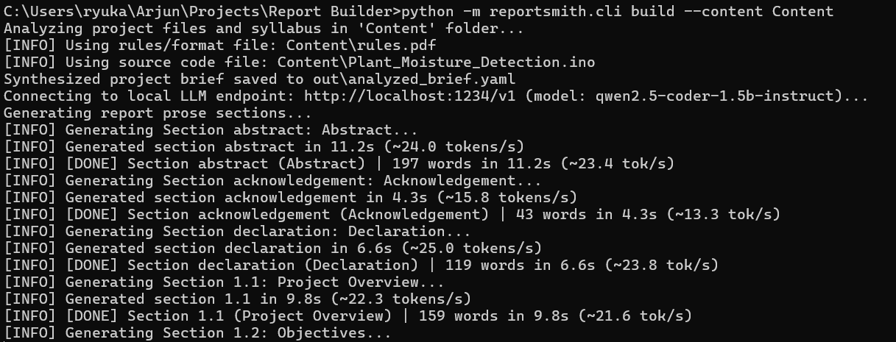
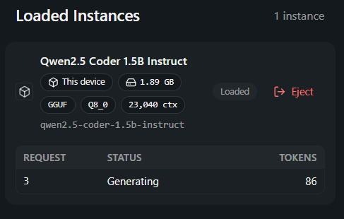
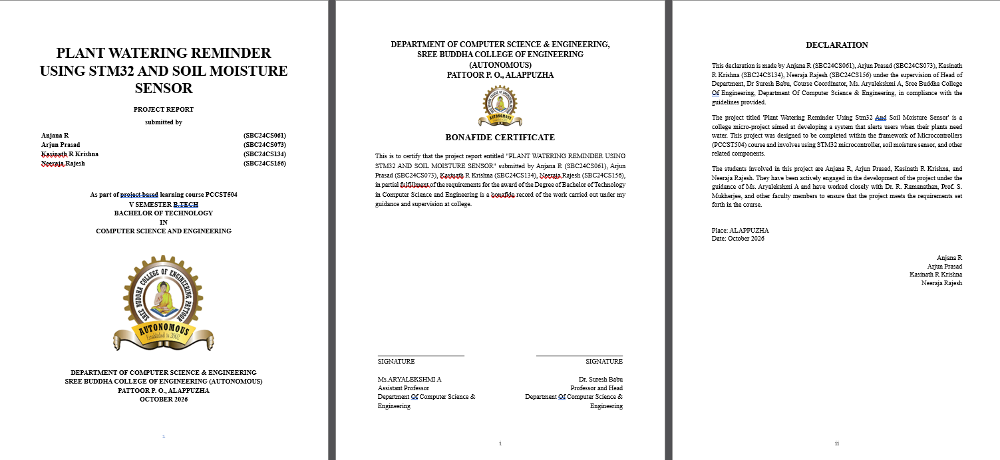

# ReportSmith 📄⚡

**ReportSmith** is an intelligent, offline technical report generation tool powered by specialized local language models and a deterministic factual synthesis engine. It autonomously transforms raw project assets, source materials, specifications, and format guidelines into publication-grade, fully formatted Microsoft Word (`.docx`) reports.

ReportSmith solves technical inaccuracies and document formatting challenges through a hybrid architecture:
- **Trained Local Model**: Generates formal, publication-standard technical prose, methodology explanations, literature reviews, and domain analysis.
- **Deterministic Python Engine**: Derives document structure, typography, section hierarchies, technical parameters, data tables, architectural diagrams, execution flowcharts, and source appendices directly from verified inputs.

---

## 📸 Demo Showcase

| 🚀 Automated CLI Build | 🧠 Local Model Generation | 📄 Raw Generated Document |
| :---: | :---: | :---: |
|  |  |  |
| *Single-command automated pipeline* | *Trained model inference via Ollama / LM Studio* | *Complete unedited output with title, certificate & layout* |

---

## 💡 How It Works & How Well It Works

### ⚙️ How It Works
ReportSmith strictly bifurcates technical generation to eliminate hallucinations while preserving rigorous, publication-ready academic quality:
1. **Drop Project Files in `Content/`**: Place your project source files, technical specifications, and formatting requirements (`rules.pdf`, syllabus, or `format.txt`) into the `Content/` folder.
2. **Deterministic Information Extraction**: ReportSmith analyzes the input documentation and codebase, automatically mapping system architectures, specifications, operational parameters, and structural rules into a validated project brief.
3. **Bifurcated Model Generation**:
   - **Trained Local Model**: Generates high-standard technical prose, theoretical foundations, abstract, and chapter narratives section-by-section based on curated context prompts.
   - **Deterministic Synthesis Engine**: Builds exact specification tables, high-resolution vector diagrams (system block diagrams, architecture schematics, logic flowcharts), mathematical formulations, and verbatim appendices. The model is never allowed to fabricate specifications or numerical data.
4. **Document Assembly & Styling**: Compiles the prose and deterministic assets into a native `.docx` document conforming to institutional standards—complete with a formal Title Page, Bonafide Certificate, Declaration, Roman-numeral preliminaries, decimal chapter numbering, styled data tables, and an automated page-numbered Table of Contents.

### 🌟 How Well It Works
- **Zero Hallucination on Technical Facts**: System architecture parameters, data classifications, and mathematical formulations are deterministically bound to source facts.
- **100% Offline & Private**: Operates entirely locally on consumer hardware without sending code, proprietary documents, or telemetry over the network.
- **High-Speed Autonomous Execution**: Generates complete multi-chapter technical documents in minutes, streaming modular sections with real-time throughput metrics.
- **Fault-Tolerant Resumption**: Employs SHA-256 disk caching (`cache/`) so interrupted runs instantly skip completed sections in milliseconds.
- **Automated Verification Engine**: Integrates a built-in compliance checker (`reportsmith check`) that validates fact adherence, structural integrity, and source fidelity.

---

## Key Features

- **100% Offline & Private**: Zero cloud dependencies, zero external network requests, zero telemetry.
- **Strict Factual Grounding**: Whitelists numbers, parameters, and specifications; automated validator (`reportsmith check`) actively blocks hallucinations.
- **Zero-Leakage Output Sanitization**: Multi-layer defensive sanitizer in the model response parser and document builder preventing markdown fences or syntax artifacts from leaking into document paragraphs.
- **Dynamic System Diagrams & Visualizations**: Automatically generates high-resolution system architecture diagrams, functional schematics, and execution flowcharts adapted to the project brief.
- **Template-Driven Design**: Inherits styles, margins, typography, and headers from reference templates (`sample.docx`).
- **Multi-Pass Page Numbering**: Headless LibreOffice integration to resolve exact page numbers in Table of Contents, List of Figures, and List of Tables.
- **Fast Resumption & Caching**: Disk-cached generation (`cache/<sha256>.json`) ensures interrupted runs never re-generate completed sections.

---

## Hardware & Performance Considerations

### Performance Expectations
When running specialized local models (such as 4-bit quantized open-source models) on consumer hardware:
- Models can run on entry-level GPUs (e.g. 4 GB VRAM) using offloading techniques or directly on system RAM (DDR4/DDR5) and CPU.
- Expected generation speed ranges from **15 to 30+ tokens/second** on lightweight models to **5 to 15 tokens/second** on larger parameter checkpoints.
- Because ReportSmith partitions tasks into modular, self-contained sections (~150 to 350 words each), each section generates in roughly **10 to 30 seconds**.
- Generating a complete multi-chapter report takes approximately **10 to 20 minutes**.
- With disk caching enabled, re-runs or resume operations skip finished sections instantly in milliseconds.

### Running with llama.cpp Server
```bash
./llama-server \
  -m models/model-q4_k_m.gguf \
  --port 11434 \
  -ngl 16 \
  -c 4096
```

### Running with Ollama / LM Studio
```bash
# Pull and serve your local model
ollama pull model-name

# Connect ReportSmith to your local endpoint (e.g., http://localhost:11434/v1 or http://localhost:1234/v1)
```

---

## Installation

### Prerequisites
- Python 3.10+ (tested on Python 3.11 / 3.12 / 3.13 on Windows, Linux, and macOS)
- (Optional) **LibreOffice** (`soffice`) for automated PDF page-number resolution
- (Optional) **Graphviz** (`dot`) for diagram rendering (Matplotlib is included as built-in fallback)

### Install via pip
```bash
# Clone or navigate to the repository
cd "c:\Users\ryuka\Arjun\Projects\Report Builder"

# Install dependencies
pip install -r requirements.txt

# Install ReportSmith in editable development mode
pip install -e .
```

---

## Quickstart & CLI Commands

> [!IMPORTANT]
> ### 🚀 Recommended One-Click Workflow
> Simply place your project specifications, formatting guidelines (`rules.pdf`), and source files into the `Content/` folder, then run:
>
> ```bash
> # Check CUDA GPU acceleration status and hardware diagnostics
> python -m reportsmith.cli --cuda
>
> # Retrain model knowledge base on training/ reference documents
> python -m reportsmith.cli --train
>
> # Build complete Word report using local model (CUDA parallel accelerated)
> python -m reportsmith.cli build --content Content
>
> # Validate generated report against facts and specifications
> python -m reportsmith.cli check out/report.docx
> ```

### 0. CUDA Hardware Acceleration & Diagnostics
ReportSmith includes native, zero-dependency CUDA hardware discovery and parallel section generation optimized for NVIDIA GPUs (e.g. GeForce RTX 2050 / 3060 / 4060 / 4090 / A100):
```bash
# Display detailed CUDA hardware report and worker recommendations
python -m reportsmith.cli --cuda

# Or via subcommand
python -m reportsmith.cli cuda
```
Example Output:
```text
================================================================
  REPORTSMITH CUDA HARDWARE ACCELERATION DIAGNOSTICS
================================================================
  * CUDA GPU Detected:        YES
  * Device Name:              NVIDIA GeForce RTX 2050
  * GPU Device Count:         1
  * Total Dedicated VRAM:     4.00 GB (4096 MB)
  * Available Free VRAM:      3.23 GB (3306 MB)
  * Compute Capability:       8.6 (Ampere / Tensor Cores)
  * Streaming Multiprocessors: 16 SMs (2048 CUDA Cores)
  * Tensor Cores Supported:   YES (3rd Gen Ampere FP16/BF16/INT4)
  * BF16 Hardware Acceleration:YES
  * NVIDIA Driver Version:    13.5
  * CUDA Toolkit (nvcc):      Cuda compilation tools, release 13.4, V13.4.92
----------------------------------------------------------------
  RECOMMENDED CONFIGURATION FOR YOUR HARDWARE:
  * Parallel Concurrency:     4 concurrent workers
  * Optimal Model Checkpoint: 1.5B - 3B (4-bit)
  * GPU Offload (num_gpu):    99 (100% layers in VRAM)
  * Context Window (num_ctx): 4096 - 8192 tokens
================================================================
```

### 1. Parallel Generation & Concurrency Control
ReportSmith batches and executes section inferences across CUDA streams and Tensor Cores concurrently:
```bash
# Run with custom parallel concurrency (e.g. 4 concurrent worker threads)
python -m reportsmith.cli build --content Content --concurrency 4
```

### 2. Retrain Model & Knowledge Base on Training Folder
Whenever you add new reference documents, sample reports, or abstracts (`.pdf` or `.docx`) into the `training/` folder, retrain the knowledge base:
```bash
# Retrain using the top-level flag
python -m reportsmith.cli --train

# Or using the train subcommand
python -m reportsmith.cli train --dir training --out-dir out
```
This autonomously:
- Ingests and parses all training files across all engineering domains (Software, Computer Organization & Architecture, Embedded Hardware, etc.).
- Catalogs authentic academic prose paragraphs, outlines, tables, and references.
- Upgrades `StubLLM` so offline test builds instantly synthesize multi-domain reports adhering to official college templates.
- Generates `out/training_database.json`, `out/train_dataset.jsonl` (for local LLM fine-tuning), and `out/Modelfile` (for Ollama).

### 1. Initialize Project Brief
Generate an editable `brief.yaml` template:
```bash
reportsmith init --out brief.yaml
```

### 2. Parse Report Format
Convert an institutional format guide or PDF syllabus into a structured `outline.json`:
```bash
reportsmith outline --format examples/format.txt --out out/outline.json
```

### 3. Build Report with Local Model
Generate the document using your local model endpoint (accelerated by CUDA and multi-threading):
```bash
reportsmith build \
  --format examples/format.txt \
  --sample examples/sample.docx \
  --brief examples/brief.yaml \
  --out out/report.docx \
  --base-url http://localhost:11434/v1 \
  --model model-name \
  --resume
```

#### Selective Section Generation
To test or re-generate specific sections only:
```bash
reportsmith build \
  --format examples/format.txt \
  --sample examples/sample.docx \
  --brief examples/brief.yaml \
  --out out/report.docx \
  --sections 1.1,3.7,4.4
```

### 4. Validate Report Grounding
Run the automated validator to verify fact integrity, check for ungrounded assertions, ensure source fidelity, and detect banned phrases:
```bash
reportsmith check out/report.docx --brief examples/brief.yaml
```

---

## Configuration (`reportsmith.toml`)

CLI flags can be defaulted in `reportsmith.toml`:
```toml
[llm]
model = "model-name"
base_url = "http://localhost:11434/v1"
timeout = 600
temperature = 0.3
reasoning_effort = "low"
seed = 42

[paths]
cache_dir = "cache"
out_dir = "out"

[compute]
use_cuda = true
concurrency = 4

[word_targets]
abstract = 250
"1.1" = 250
"1.2" = 150
"3.7" = 250
"4.4" = 300
default = 200
```

---

## Document Structure Generated

The generated `.docx` report conforms to formal publication and institutional standards:
1. **Section 1: Title Page**
   - Centred bold institution header, organizational emblem/logo area, project title in bold caps.
   - Author / Contributor details (Name, Registration/Roll ID).
   - Supervisor, Department, Institution, and Submission date.
   - Header/footer suppressed (no page numbering).
2. **Section 2: Preliminary Pages**
   - Lower-case Roman numerals (`i`, `ii`, `iii`, ...) centered in footer.
   - Bonafide Certificate with supervisor and department head signature blocks.
   - Formal Declaration and Acknowledgements.
   - Executive / Academic Abstract.
   - Table of Contents with dot leaders and right-aligned page numbers.
   - List of Figures (Figure No., Title, Page).
   - List of Tables (Table No., Title, Page).
   - List of Abbreviations and Nomenclature.
3. **Section 3: Main Body (Chapters 1 to 6)**
   - Decimal numerals starting at `1` centered in footer.
   - Each Chapter begins on a new page with bold centered uppercase title.
   - Section headings, justified body paragraphs, and structured bullet lists.
   - High-resolution embedded technical diagrams with captions:
     * Figure 3.1: System Architecture and Functional Block Diagram
     * Figure 3.2: Complete Component Interconnection Schematic
     * Figure 3.3: Execution and Logic Workflow Flowchart
   - Formatted data tables with header shading (`#EAEAEA`) and page-break prevention (`<w:cantSplit/>`):
     * Table 2.1: Primary System Technical Specifications
     * Table 2.2: Component & Subsystem Specifications
     * Table 3.1: Interface & Pin Mapping Configuration
     * Table 3.2: State Classification & Operational Parameters
     * Table 5.1: Validation Test Matrix and Expected Behaviors
   - Labelled placeholder callouts for hardware photographs, benchmark charts, or visual evidence.
4. **End Matter**
   - References cited sequentially (`[1]`, `[2]`, ...).
   - Appendix A: Complete Source Implementation verbatim in shaded monospaced blocks.
   - Appendix B: System configuration and parameters.
   - Appendix C: Supplementary outputs and test logs.

---

## Manual Verification Checklist

After running ReportSmith to generate your report, review the following items:
- [ ] **Institutional Signatures**: Confirm that supervisor and department details on the Certificate page match exact institutional titles.
- [ ] **Visual Evidence**: Replace placeholder boxes in experimental chapters with actual system captures, oscilloscope traces, or UI photographs.
- [ ] **Observed Results**: If physical experimental measurements were recorded, update observed results in test tables (mathematically modeled values are provided by default).
- [ ] **Print Margins & Binding**: Inspect page boundaries in Word or PDF to ensure margins accommodate physical spiral or hard-binding.

---

## Running Automated Tests

Run the complete test suite (unit tests, boundary calculations, verbatim appendix checks, validator checks, dynamic diagrams, and integration tests):
```bash
pytest -v
```
All tests execute in under 8 seconds.

---

## ⚡ Quick Reference Commands

> [!TIP]
> ### 📋 Daily Command Cheat Sheet
> Run these commands from your repository root directory:
>
> ```bash
> # 1. Check CUDA GPU hardware diagnostics & parallel workers
> python -m reportsmith.cli --cuda
>
> # 2. Retrain model database after adding new documents to training/
> python -m reportsmith.cli --train
>
> # 3. Generate full Word report using local model (CUDA parallel accelerated)
> python -m reportsmith.cli build --content Content
>
> # 4. Validate generated report for accuracy and compliance
> python -m reportsmith.cli check out/report.docx
> ```
Concurrent mode
python -m reportsmith.cli build --concurrency 2 --content Content

---

## 🌐 Universal Subject & Multi-Domain Support

ReportSmith is a universal report builder that operates across all academic disciplines, engineering branches, and software domains:
- **Embedded & Microcontroller Hardware**: Pin allocations, register configurations, sensor telemetry, and hardware schematics.
- **Software Applications & Full-Stack Systems**: Architecture layers, MVC/services, UI terminals, file/database persistence, and software test cases.
- **Computer Organization & Architecture (COA)**: RISC-V pipelining, datapath schematics, MMIO interconnects, and assembly verification routines.
- **General & Interdisciplinary Projects**: Autonomous requirement matrices, execution workflows, and scientific validation tables.

### Autonomous Synthesis (When No Rules File is Present)
If no syllabus or format rules file is present in `Content/`, ReportSmith automatically:
1. Analyzes the project abstract (e.g., `Project.pdf`, `Project.docx`, or `abstract.pdf`).
2. Detects the engineering discipline and domain.
3. Dynamically invents necessary modules and subheadings (e.g. Chapter 4 modular subsystems).
4. **Preserves the Strict Structural Invariant**: The institutional sequence is guaranteed across all subjects:
   *Front page, Bonafide certificate, Declaration, Acknowledgement, Abstract, Content (TOC), List of figures, List of tables, List of abbreviations, Introduction, Requirements, System design, Implementation, Testing and results, Conclusion, References, and Source code (when code is present).*
