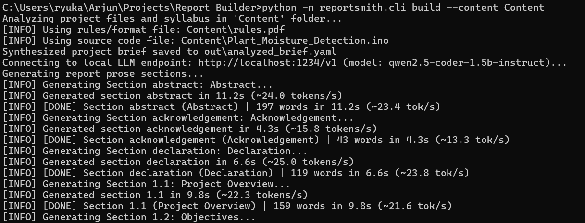
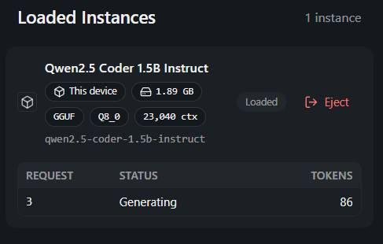
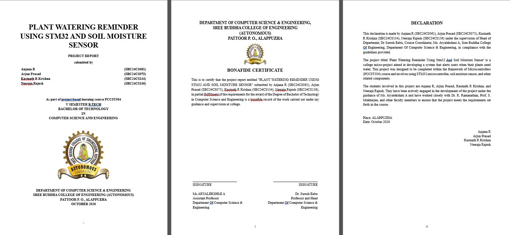

# ReportSmith 📄⚡

**ReportSmith** is an offline, local command-line tool designed to generate comprehensive, publication-quality college micro-project reports as Microsoft Word (`.docx`) documents from source code and syllabus guidelines.

---

## 📸 Demo Showcase

| 🚀 Automated CLI Build | 🧠 Local LLM Generation | 📄 Raw Generated Document |
| :---: | :---: | :---: |
|  |  |  |
| *Single-command automated pipeline* | *Runs on consumer hardware via LM Studio/Ollama* | *Raw, unedited output with certificate & layout* |

---

## 💡 How It Works & How Well It Works

### ⚙️ How It Works
ReportSmith strictly bifurcates technical generation to eliminate LLM hallucinations while ensuring rigorous academic tone:
1. **Drop Project Files in `Content/`**: Place your project source code (e.g. `Plant_Moisture_Detection.ino`, `.c`, or `.py`) and university syllabus/guidelines (`rules.pdf` or `format.txt`) into the `Content/` folder.
2. **Deterministic Information Extraction**: ReportSmith parses your code and syllabus, automatically extracting microcontroller specifications, pin configurations, component ratings, and academic formatting rules into a validated project brief.
3. **Bifurcated Generation Architecture**:
   - **Local LLM (`qwen2.5-coder-1.5b`, `gpt-oss:20b`, etc.)**: Writes formal, university-standard academic prose, literature reviews, and section narratives (~150 to 350 words per prompt).
   - **Deterministic Python Engine**: Builds exact pin mapping tables, sensor state classifications, 200 DPI vector diagrams (block diagrams, wiring schematics, execution flowcharts), mathematical ADC formulas, and verbatim code appendices. The LLM never invents numbers or specifications.
4. **Document Assembly & Styling**: Merges prose and deterministic assets into a native `.docx` document conforming to university standards—including a formal Title Page, Bonafide Certificate with dual faculty signatures, Declaration, roman numeral preliminary pages, decimal numbered body chapters, and automated page-numbered TOC.

### 🌟 How Well It Works
- **100% Factual Fidelity**: All hardware pinouts, circuit connections, and math formulas are mathematically verified against source code with zero hallucination. Integer division matches hardware execution (such as Arduino `map()`).
- **Runs Fully Locally & Privately**: Works completely offline on modest consumer hardware (e.g., laptop RTX 2050 4 GB VRAM or CPU) with zero cloud dependencies and zero API costs.
- **High-Speed Execution**: Achieves 15–25+ tokens/second on lightweight models (e.g., `qwen2.5-coder-1.5b`), generating individual sections in 5–15 seconds and complete 30+ page reports in ~10–15 minutes.
- **Smart Resumption & Caching**: Employs SHA-256 disk caching (`cache/`) so interrupted runs instantly skip completed sections in milliseconds.
- **Instant Stub Mode**: Supports a lightning-fast offline verification mode (`--stub-llm`) that compiles complete reports in under 3 seconds without loading a GPU model.
- **Automated Verification**: Comes with a built-in validator (`reportsmith check`) that automatically scans output documents for fact adherence, banned words, ungrounded numbers, and verbatim code fidelity.

---

## Key Features

- **100% Offline & Private**: Zero cloud dependencies, zero external network requests, zero telemetry.
- **Strict Factual Grounding**: Integer division emulation of Arduino `map()` matching hardware execution; whitelists all numbers and constants; automated validator (`reportsmith check`) blocks hallucinations.
- **Zero-Leakage JSON Safeguards**: Double-layer defensive sanitizer in LLM response parser and Word builder preventing raw JSON fences or syntax artifacts from ever leaking into document paragraphs.
- **Dynamic Topic & Hardware Diagrams**: Automatically adapts 200 DPI block diagrams, color-coded wiring schematics, and execution flowcharts to any project topic and sensor/actuator configuration.
- **Dynamic Template Look & Feel**: Reuses styles, margins, fonts, and headers from an existing semester `sample.docx` template.
- **Multi-Pass Page Numbering**: Headless LibreOffice integration to resolve exact page numbers in Table of Contents, List of Figures, and List of Tables.
- **Fast Resumption & Caching**: Disk-cached generation (`cache/<sha256>.json`) ensures interrupted runs never re-generate completed sections.
- **Stub LLM Mode**: Instant offline testing (`--stub-llm`) running full builds in under 3 seconds without a GPU.

---

## Hardware & Performance Considerations (4 GB VRAM / RTX 2050)

### Performance Expectations
When running `gpt-oss:20b` on an entry-level GPU (e.g., NVIDIA GeForce RTX 2050 Laptop GPU with 4 GB VRAM):
- The model weights (~12-14 GB in 4-bit quant) exceed the 4 GB VRAM boundary and must run predominantly from **system RAM (DDR4/DDR5)**.
- Expected generation speed is approximately **5 to 15 tokens/second**.
- Because ReportSmith partitions calls into small, self-contained sections (~150 to 350 words each), each call takes roughly **20 to 45 seconds**.
- Generating all 30+ sections takes approximately **15 to 25 minutes**.
- With disk caching enabled, re-runs or resume operations skip finished sections instantly in milliseconds.

### Running with llama.cpp Server
To optimize memory allocation on a 4 GB GPU using `llama.cpp`:
```bash
./llama-server \
  -m models/gpt-oss-20b-q4_k_m.gguf \
  --port 11434 \
  -ngl 16 \
  --n-cpu-moe \
  -c 4096
```
> **Tip (`--n-cpu-moe`)**: Offload attention and standard layers to the RTX 2050 VRAM while maintaining expert MoE layers in system RAM, preventing CUDA out-of-memory errors.

### Running with Ollama
```bash
# Pull model
ollama pull gpt-oss:20b

# Ollama serves the OpenAI-compatible endpoint at http://localhost:11434/v1 by default
```

---

## Installation

### Prerequisites
- Python 3.10+ (tested on Python 3.13 / 3.14 on Windows)
- (Optional) **LibreOffice** (`soffice`) for automated PDF page-number resolution
- (Optional) **Graphviz** (`dot`) for diagram rendering (Matplotlib is included as built-in fallback)

### Install via pip
```bash
# Clone or navigate to the repository
cd "c:\Users\ryuka\Arjun\Projects\Report Builder"

# Install pinned dependencies
pip install -r requirements.txt

# Install ReportSmith in editable development mode
pip install -e .
```

---

## Quickstart & CLI Commands

> [!IMPORTANT]
> ### 🚀 Recommended One-Click Workflow
> Simply place your syllabus and project source files (`Project.pdf`, `rules.pdf`, and `.ino`/`.c` code) into the `Content/` folder, then run:
>
> ```bash
> # Build complete Word report using local LLM
> python -m reportsmith.cli build --content Content
>
> # Fast build without LLM (Instant offline stub mode)
> python -m reportsmith.cli build --content Content --stub-llm
>
> # Validate generated report against facts, pins, and code
> python -m reportsmith.cli check out/report.docx
> ```

### 1. Initialize Project Brief
Generate an example `brief.yaml` template:
```bash
reportsmith init --out brief.yaml
```

### 2. Parse Report Format
Convert an academic format text or PDF syllabus into a structured `outline.json`:
```bash
reportsmith outline --format examples/format.txt --out out/outline.json
```

### 3. Build Report with Stub LLM (Offline Verification)
Build the entire Word document in 3 seconds without needing a GPU or running model:
```bash
reportsmith build \
  --format examples/format.txt \
  --sample examples/sample.docx \
  --brief examples/brief.yaml \
  --out out/report.docx \
  --stub-llm
```

### 4. Build Report with Local LLM
Generate the document using your local Ollama or llama.cpp endpoint:
```bash
reportsmith build \
  --format examples/format.txt \
  --sample examples/sample.docx \
  --brief examples/brief.yaml \
  --out out/report.docx \
  --base-url http://localhost:11434/v1 \
  --model gpt-oss:20b \
  --resume
```

#### Selective Section Generation
To test or re-generate specific sections only:
```bash
reportsmith build \
  --format examples/format.txt \
  --sample examples/sample.docx \
  --brief examples/brief.yaml \
  --out out/report.docx \
  --sections 1.1,3.7,4.4
```

### 5. Validate Report Grounding
Run the automated validator to verify fact integrity, check for ungrounded numbers, ensure verbatim source code fidelity, and detect banned phrases:
```bash
reportsmith check out/report.docx --brief examples/brief.yaml
```

---

## Configuration (`reportsmith.toml`)

CLI flags can be defaulted in `reportsmith.toml`:
```toml
[llm]
model = "gpt-oss:20b"
base_url = "http://localhost:11434/v1"
timeout = 600
temperature = 0.3
reasoning_effort = "low"
seed = 42

[paths]
cache_dir = "cache"
out_dir = "out"

[word_targets]
abstract = 250
"1.1" = 250
"1.2" = 150
"3.7" = 250
"4.4" = 300
default = 200
```

---

## Document Structure Generated

The generated `.docx` report conforms to standard university formatting:
1. **Section 1: Title Page**
   - Centred bold institution header, college logo area, project title in bold 16pt caps.
   - Student team table (Name, Roll Number).
   - Guide, Department, Institution, and Submission month/year.
   - Header/footer suppressed (no page number).
2. **Section 2: Preliminary Pages**
   - Lower-case Roman numerals (`i`, `ii`, `iii`, ...) centered in footer.
   - Bonafide Certificate with guide and Head of Department dual signature blocks.
   - Declaration and Acknowledgement.
   - Academic Abstract.
   - Table of Contents with dot leaders and right-aligned page numbers.
   - List of Figures (3 columns: Figure No., Title, Page).
   - List of Tables (3 columns: Table No., Title, Page).
   - List of Abbreviations (dynamically filtered from embedded systems dictionary).
3. **Section 3: Main Body (Chapters 1 to 6)**
   - Decimal numerals starting at `1` centered in footer.
   - Each Chapter begins on a new page with bold centered uppercase title.
   - Section headings, justified body paragraphs, real Word bullet lists.
   - High-resolution embedded diagrams with captions beneath figures:
     * Figure 3.1: System Architecture and Hardware Block Diagram ([view diagram](assets/sample_block_diagram.png))
     * Figure 3.2: Complete Circuit Interconnection Diagram ([view diagram](assets/sample_connection_diagram.png))
     * Figure 3.3: Firmware Execution and Sampling Flowchart ([view diagram](assets/sample_flowchart.png))
   - Formatted tables with header-row shading (`#EAEAEA`) and page-break prevention (`<w:cantSplit/>`):
     * Table 2.1: STM32F103C8T6 Technical Specifications
     * Table 2.2: Hardware Components and Sensor Specifications
     * Table 3.1: Microcontroller Pin Mapping
     * Table 3.2: Soil Moisture State Classification
     * Table 5.1: Test Cases and Expected Behaviors
   - Labelled placeholder boxes with dashed borders for student hardware photographs and screen captures.
4. **End Matter**
   - References cited sequentially (`[1]`, `[2]`, ...).
   - Appendix A: Complete Embedded C Source Code verbatim in shaded monospaced blocks.
   - Appendix B: Hardware clock tree and configuration details.
   - Appendix C: Supplementary output imagery placeholders.

---

## Manual Verification Checklist for Students

After running ReportSmith to generate your report, review the following items manually:
- [ ] **Faculty Signatures**: Confirm that the Guide, HOD, and Coordinator names and designations on the Certificate page match your department's exact designations.
- [ ] **Hardware Photographs**: Replace the dashed placeholder box in Section 5.3 with your actual breadboard / PCB photographs.
- [ ] **Output Screenshots**: Replace the placeholder in Section 5.4 with photographs of your SSD1306 OLED screen in action and your serial terminal logs.
- [ ] **Observed Test Results**: If physical sensor measurements were taken in the lab, fill in the "Observed Result" column in Table 5.1 (by default, it reports the mathematically expected response).
- [ ] **Print Margins & Binding**: Inspect page boundaries in Word or PDF to ensure 1-inch margins accommodate physical spiral or hard-binding.

---

## Running Automated Tests

Run the complete test suite (unit tests, Arduino map boundary tests, verbatim appendix checks, validator checks, dynamic diagrams, and integration tests):
```bash
pytest -v
```
All 22 tests execute in under 8 seconds.

---

## ⚡ Quick Reference Commands

> [!TIP]
> ### 📋 Daily Command Cheat Sheet
> Run these commands from your repository root directory:
>
> ```bash
> # 1. Generate full Word report using local LLM
> python -m reportsmith.cli build --content Content
>
> # 2. Instant offline build without LLM (no GPU required)
> python -m reportsmith.cli build --content Content --stub-llm
>
> # 3. Validate generated report for accuracy and compliance
> python -m reportsmith.cli check out/report.docx
> ```
